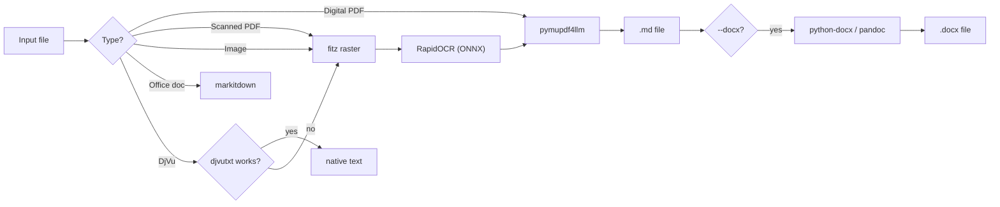

<!-- SPDX-FileCopyrightText: 2026 kirijin <avel.ronin@gmail.com> -->
<!-- SPDX-License-Identifier: MIT -->

<p align="center">
  
</p>

<p align="center">
  <b>mark-dawn</b> — drop a document, get clean Markdown.
</p>

mark-dawn watches a folder and converts anything you drop in: scanned PDFs (OCR), digital PDFs, DjVu, photos of documents, Office files. Optional styled DOCX output.

## Install

All installers need no root/sudo and put `mark-dawn` in `~/.local/bin/`.

### Linux (any distro with podman or docker) — Podman/Docker container:
```bash
curl -fsSL https://raw.githubusercontent.com/kirijin/mark-dawn/main/install.sh | bash
```

### macOS 26+ (Tahoe) — Apple Container:
```bash
curl -fsSL https://raw.githubusercontent.com/kirijin/mark-dawn/main/install-macos-container.sh | bash
```

### macOS pre-26 — Homebrew + Python venv: the universal installer auto-detects and runs the Homebrew path (pandoc + djvulibre via brew, Python venv with the rest).

### Windows (PowerShell 3+) — MSYS2 portable, no admin:
```powershell
powershell -c "iwr -Uri 'https://raw.githubusercontent.com/kirijin/mark-dawn/main/install.ps1' -UseBasicParsing | iex"
```

Self-contained in `%USERPROFILE%\mark-dawn\`. No admin, no package manager.

## Use

```bash
mark-dawn start                 # watcher on ~/Documents/Inbox
mark-dawn stop
mark-dawn convert file.pdf      # → ~/Documents/Research/file.md
mark-dawn convert scan.djvu --docx
mark-dawn convert scan.pdf --langs eng+rus
mark-dawn logs                  # follow watcher logs
mark-dawn status
mark-dawn update
```

Windows:
```powershell
& "$env:USERPROFILE\mark-dawn\mark-dawn.bat" start
& "$env:USERPROFILE\mark-dawn\mark-dawn.bat" convert "C:\doc.pdf"
```

## How it works

Drop a file into `Inbox/` (or `Inbox/2docx/` for DOCX, `Inbox/2md/` for explicit MD routing). The watcher picks it up after a 3s debounce.

| Extension | Handler |
|-----------|---------|
| `.pdf` | digital (pymupdf4llm) or scanned (fitz render → RapidOCR) |
| `.djvu` | djvutxt, fallback to render → OCR |
| images | RapidOCR directly |
| Office / html / csv / rtf | markitdown |
| plugins | `HANDLERS` registry (see below) |

Output lands in `Research/`. Original removed on success, moved to `Inbox_Failed/` on failure.

### Pipeline



### Plugins

Add a handler without touching core: drop a module into `~/.config/mark-dawn/plugins/`, set `MARK_DAWN_PLUGINS=module.name`, or ship a pip package with a `mark_dawn.handlers` entry point. A handler needs `.extensions` (set of suffixes) and `.convert(file_path, out_md)`. See `examples/plugin_txt.py`.

### OCR

Six languages by default: `eng+rus+fra+deu+chi_sim+jpn`. Set via `MARK_DAWN_LANGS=eng+spa+ara+por`. Codes are Tesseract-style and mapped to RapidOCR types internally — no separate language pack install.

Digital vs scanned PDF detection: MuPDF measures average text chars/page. Above 100 → digital (fast path). At or below → render at 200 DPI and OCR. Scanned renders capped at 50 pages (`MARK_DAWN_MAX_PAGES`), max dimension 2400px (`MARK_DAWN_MAX_DIM`).

## Configuration

Environment variables (also `mark-dawn config set --data-dir ~/Docs --langs eng+spa`):

| Variable | Default | Purpose |
|----------|---------|---------|
| `MARK_DAWN_DATA_DIR` | `~/Documents` | base data directory |
| `MARK_DAWN_LANGS` | `eng+rus+fra+deu+chi_sim+jpn` | OCR languages |
| `MARK_DAWN_INBOX_DIR` | `$DATA_DIR/Inbox` | input watch folder |
| `MARK_DAWN_OUT_DIR` | `$DATA_DIR/Research` | output destination |
| `MARK_DAWN_FAILED_DIR` | `$DATA_DIR/Inbox_Failed` | failed conversions |
| `MARK_DAWN_MAX_PAGES` | `50` | max PDF pages |
| `MARK_DAWN_MAX_DIM` | `2400` | max image dimension (px) |
| `MARK_DAWN_MAX_INPUT_MB` | `200` | input size cap |
| `MARK_DAWN_WORKERS` | `1` | watcher threads |
| `MARK_DAWN_STATUS_PORT` | `0` | HTTP status endpoint (0 = off) |
| `MARK_DAWN_KEEP_RAW` | unset | write `.raw` sidecar |
| `MARK_DAWN_LLM_URL` | unset | optional LLM cleanup endpoint |
| `MARK_DAWN_LLM_CLEANUP` | unset | enable LLM cleanup (`1`) |
| `MARK_DAWN_PLUGIN_DIR` | `~/.config/mark-dawn/plugins` | plugin discovery |
| `MARK_DAWN_PLUGINS` | unset | comma-separated plugin modules |
| `MARK_DAWN_IMAGE` | `docker.io/kirijin/mark-dawn:latest` | container image |

## Build locally

```bash
git clone https://github.com/kirijin/mark-dawn.git
cd mark-dawn
podman build -t mark-dawn:latest .
pip install pymupdf4llm markitdown[all] watchdog python-docx
python3 convert_pdf.py ~/doc.pdf
```

## Troubleshooting

- **Container won't start (Linux)**: ensure podman/docker runs (`podman info`). The launcher handles SELinux `:Z` mounts.
- **OCR inaccurate / missing languages**: `mark-dawn config set --langs eng+spa+ara+por && mark-dawn restart`.
- **`--docx` ignored**: old `entrypoint.sh` dropped args — fixed. `mark-dawn update`.
- **macOS Apple Container won't start**: check arch — `container run --rm --arch linux/arm64 docker.io/kirijin/mark-dawn:latest uname -m`.
- **Windows DLL errors**: `.\\mark-dawn.ps1 -ForceRedownload`.

## Credits

- [pymupdf4llm](https://pypi.org/project/pymupdf4llm/) — PDF→Markdown
- [markitdown](https://pypi.org/project/markitdown/) — Office docs→Markdown
- [RapidOCR](https://github.com/RapidAI/RapidOCR) — ONNX OCR, replaces Tesseract
- [onnxruntime](https://onnxruntime.ai/) — inference engine
- [djvulibre](https://djvu.sourceforge.net/) — DjVu processing
- [watchdog](https://pypi.org/project/watchdog/) — filesystem watcher
